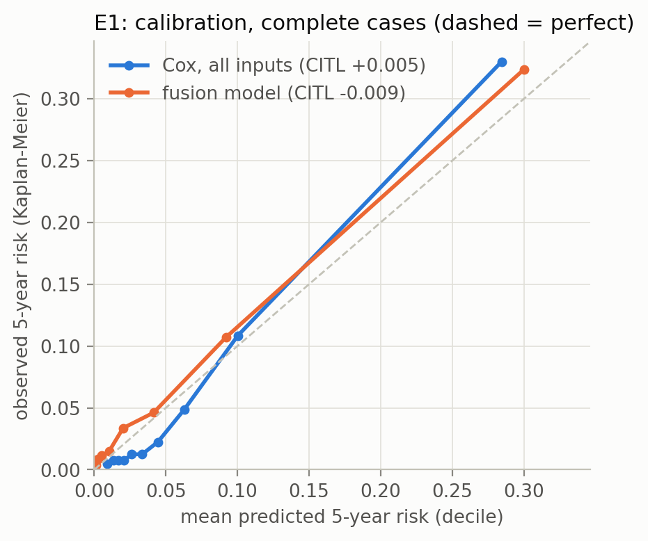
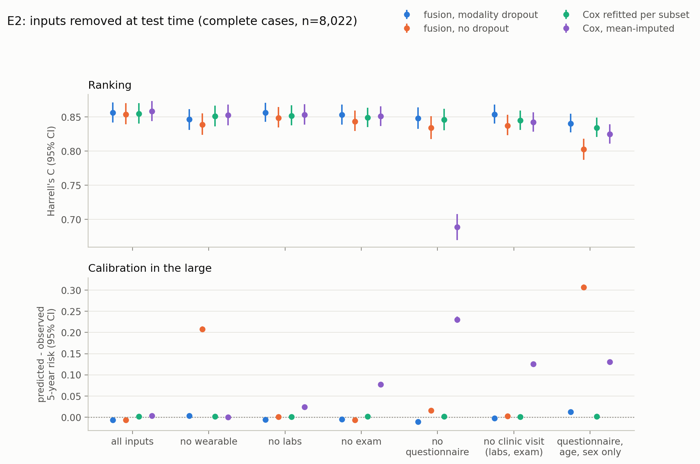
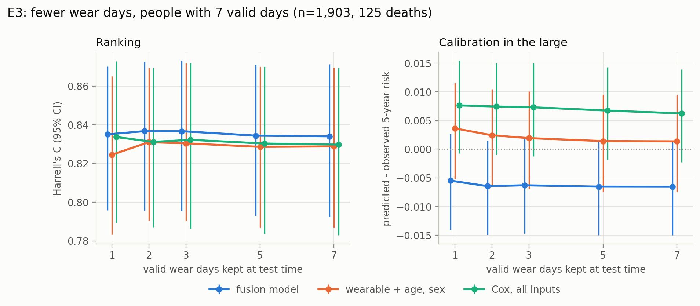
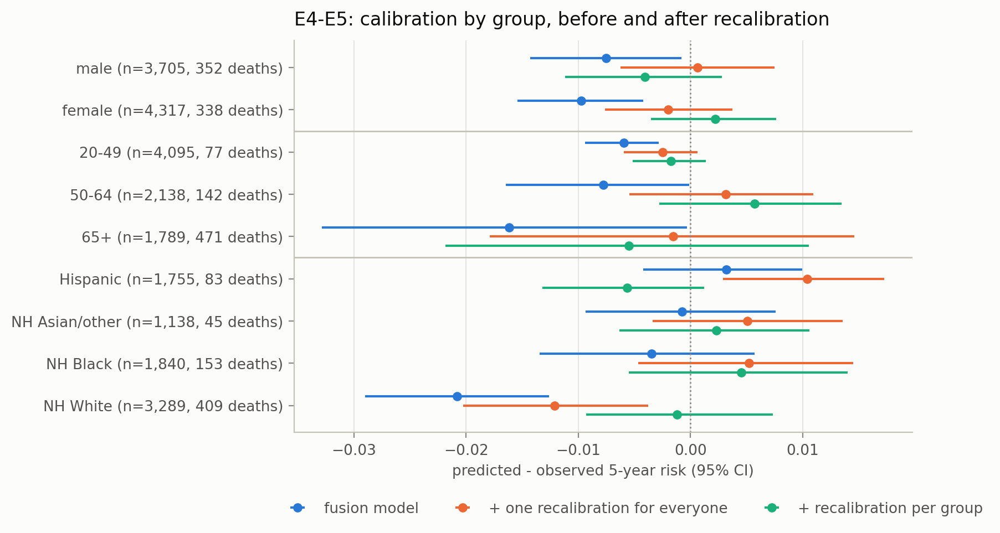
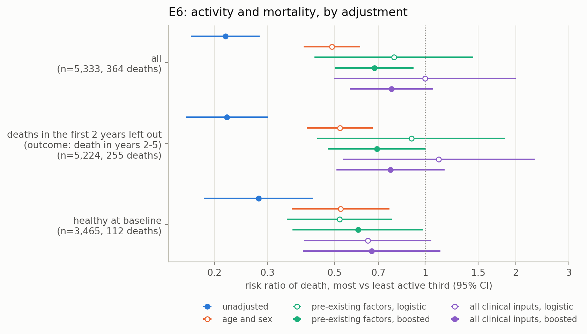

# Mortality risk from a wrist wearable and clinical data when parts are missing

When the wearable or the lab panel is missing, how much does a combined mortality-risk model lose, and is it equally well calibrated across groups?

This repository studies that question on NHANES 2011–2014: one week of minute-level wrist accelerometry, a clinical exam, blood tests and a questionnaire for 10,886 US adults, linked to death records up to the end of 2019. It covers:

- **Multimodal survival modelling:** a deep fusion model that reads the raw minute-level activity of every valid wear day together with tabular clinical data, against penalised Cox models on the same inputs (E1).
- **Missing data types:** the wearable, the labs, the exam or the questionnaire removed at test time, and the people who really lack them (E2).
- **Irregular wear:** how many valid wear days a prediction needs (E3).
- **Subgroup calibration:** whether predicted risk matches observed mortality by sex, age and race/ethnicity (E4), and whether recalibration closes the gaps, and at what cost (E5).
- **Activity as a possible cause:** how much of the association between daily activity and mortality survives adjustment and checks for reverse causation (E6).

All numbers are out-of-fold: every person is scored by models that never saw them in training (5-fold cross-fitting). Confidence intervals are 95% intervals from a bootstrap that resamples people (1,000 resamples), except in E6, where they come from influence functions. Differences between two models are computed on the same resampled people.

This is the companion study to [missing-pieces-ecg](https://github.com/sabaso94/missing-pieces-ecg), which asks the same reliability questions of a deep ECG classifier on PTB-XL.

## Motivation

A risk model for people with chronic disease will rarely get every input it was built with:

- Wearables are taken off, forgotten or not worn long enough. Some people never wear one.
- Remote monitoring means no clinic visit, so no blood test and no blood pressure.
- Patients differ from the population the model was fitted on.

A model fit for that setting should lose little when an input is missing. It should not mislead about absolute risk when it does, and its risks should mean the same for every group of patients. Each experiment tests one of these properties directly, on ranking (who is at higher risk) and on calibration (how high that risk is).

## Data and setup

| | |
|---|---|
| Source | NHANES 2011–2012 and 2013–2014: minute-level wrist accelerometry (PhysioNet release, MIMS), exam, labs and questionnaire files, and the NCHS public-use linked mortality files (follow-up to 31 Dec 2019) |
| Cohort | Adults aged 20+ eligible for mortality linkage: **10,886 people, 1,022 deaths** (677 within 5 years), median follow-up 6.75 years, mean age 49.0, 51.5% women |
| Complete cases | All four input blocks present: 8,022 people, 690 deaths (451 within 5 years). Only 23 are censored before 5 years. |
| Outcome | Time to death from any cause; reported metrics are at a 5-year horizon |
| Inputs | **Core:** age, sex (always present). **Wearable:** the minute-level activity of up to 7 valid days. **Labs (9):** HbA1c, total and HDL cholesterol, creatinine, albumin, alkaline phosphatase, white cell count, haemoglobin, RDW. **Exam (5):** BMI, waist, systolic and diastolic blood pressure, grip strength. **Questionnaire (11):** smoking (current, former), self-rated health, education, income-to-poverty ratio, diabetes, heart failure, coronary disease, heart attack, stroke, cancer. Race/ethnicity is never a model input. |
| Valid wear day | At least 95% of the 1,440 minutes worn and unflagged (Leroux et al., 2019) |
| Folds | 5 folds stratified by death and survey cycle. Inside each training part, 20% is held out for early stopping and recalibration. |

Who lacks which block, in the full cohort:

| Missing | People | Deaths |
|---|---|---|
| Wearable (no valid wear day) | 2,616 | 290 |
| Labs | 458 | 70 |
| Exam | 20 | 4 |
| Questionnaire | 0 | 0 |

**Models.**

- **Cox models** (lifelines, ridge penalty 0.1): age and sex only; clinical (core, labs, exam, questionnaire); and full (clinical plus 10 activity summaries per person). The activity summaries are total MIMS, active minutes (MIMS ≥ 10.558, Karas et al., 2022), peak 30-minute MIMS, active-to-sedentary and sedentary-to-active transition probabilities, M10, L5, relative amplitude, intradaily variability and the number of valid days. Missing values are mean-imputed with a missing indicator. Standardised values are clipped at ±5 SD.
- **Fusion model:** a discrete-time survival network with yearly intervals and a logistic-hazard loss (Gensheimer and Narasimhan, 2019; Kvamme and Borgan, 2021).
  - A 1D CNN encodes each valid wear day: activity, worn/not worn, and time of day.
  - A masked mean pools the days.
  - An MLP encodes the tabular inputs.
  - A head combines both with one present/absent flag per block.
  - **Modality dropout** (Neverova et al., 2016): in training, each present block is removed with probability 0.3, exactly as a missing block looks at test time. Each person keeps a random 1 to n of their n valid days.
  - Five seeds per fold, averaged. Early stopping is on the hold-out C-index.
- **Metrics:**
  - **Ranking:** Harrell's C (Harrell et al., 1982) and Uno's C at 5 years (Uno et al., 2011).
  - **Overall accuracy:** IPCW Brier score at 5 years (Graf et al., 1999).
  - **Calibration-in-the-large (CITL):** mean predicted 5-year risk minus the Kaplan–Meier observed 5-year risk. A positive CITL means the model over-predicts.

## Results

### E1: baselines and fusion

Complete cases (n = 8,022, 451 deaths within 5 years):

| Model | Harrell's C | Uno's C (5 y) | Brier (5 y) | CITL (5 y) |
|---|---|---|---|---|
| Cox, age + sex | 0.820 [0.803, 0.835] | 0.821 | 0.0491 | +0.007 [+0.002, +0.012] |
| Cox, clinical | 0.854 [0.839, 0.869] | 0.861 | 0.0440 | +0.003 [−0.002, +0.007] |
| Cox, full (clinical + activity summaries) | **0.858** [0.844, 0.873] | 0.866 | 0.0427 | +0.004 [−0.001, +0.008] |
| Deep, wearable + age, sex | 0.840 [0.825, 0.856] | 0.846 | 0.0435 | −0.002 [−0.007, +0.002] |
| Deep, clinical (no wearable) | 0.850 [0.835, 0.865] | 0.858 | 0.0431 | +0.001 [−0.004, +0.005] |
| **Fusion** | **0.856** [0.842, 0.871] | 0.865 | **0.0423** | −0.007 [−0.011, −0.003] |

- **The fusion model ranks as well as the best Cox model.** The difference is −0.002 [−0.007, +0.003] in Harrell's C, and its Brier score is as good (−0.0004 [−0.0014, +0.0005]).
- **The wearable carries real signal on its own.** One week of wrist activity plus age and sex adds +0.021 [+0.013, +0.028] C over age and sex alone.
- **Beyond a full clinical work-up it adds little.** Activity summaries add +0.004 [−0.0005, +0.009] to the clinical Cox model.
- **The fusion model under-predicts slightly.** Its mean predicted 5-year risk is 0.7 percentage points below the observed risk. The full Cox model is within 0.4 points, with an interval that includes zero.



### E2: missing data types

**Simulated.** On the complete cases, blocks are removed at test time, one or several at a time. Two settings stand for remote monitoring: "no clinic visit" (no labs, no exam) and "questionnaire, age and sex only". Four approaches are compared:

1. **Fusion, modality dropout:** the E1 fusion model. One model serves every condition.
2. **Fusion, no dropout:** the same network trained on complete cases without modality dropout. A removed block is filled with zeros and its flag is turned off; its missing indicators stay 0, as they were in its complete-case training data.
3. **Cox refitted per subset:** a separate Cox model for each combination of present blocks. This is the per-subset reference.
4. **Cox, mean-imputed:** the full Cox model, with the removed block mean-imputed and its missing indicators set.

| Harrell's C | Fusion, dropout | Fusion, no dropout | Cox per subset | Cox mean-imputed |
|---|---|---|---|---|
| All inputs | 0.856 | 0.854 | 0.855 | 0.858 |
| No wearable | 0.846 | 0.839 | 0.851 | 0.853 |
| No labs | 0.856 | 0.849 | 0.852 | 0.853 |
| No exam | 0.853 | 0.844 | 0.849 | 0.851 |
| No questionnaire | 0.848 | 0.834 | 0.846 | 0.689 |
| No clinic visit (no labs, no exam) | **0.854** | 0.837 | 0.845 | 0.842 |
| Questionnaire, age, sex only | **0.841** | 0.803 | 0.834 | 0.825 |



- **Modality dropout is what makes one model work for every condition.** The fusion model with dropout ranks better than the same network without it under every removal, from +0.007 [+0.003, +0.012] (no wearable) to +0.038 [+0.030, +0.046] (questionnaire, age and sex only). The larger difference is in calibration (below).
- **One fusion model matches a Cox model refitted for each subset.** It is better in both remote-monitoring settings: +0.009 [+0.002, +0.014] with no clinic visit, and +0.006 [+0.001, +0.011] with questionnaire, age and sex only. Without a clinic visit it loses only 0.002 [−0.003, +0.008] against all inputs.
- **Calibration separates the approaches more than ranking does.**
  - The fusion model with dropout stays within −0.010 to +0.013 CITL in every condition, and the per-subset Cox model within +0.001 to +0.002.
  - Without dropout, the network over-predicts 5-year risk by 21 percentage points when the wearable is missing (CITL +0.208), and by 31 points with questionnaire, age and sex only (+0.307).
  - The mean-imputed Cox model over-predicts by 23 points without the questionnaire (+0.230), and by 13 points without a clinic visit (+0.126).
- **Missing indicators fitted on rare missingness give arbitrary risks.**
  - **No one in the cohort lacks the whole questionnaire;** single answers are missing for a few people. Removing the questionnaire switches all its indicators on at once, which adds the same amount to every person's Cox risk score within a fold.
  - **That amount differs between folds.** It comes from indicator coefficients fitted on those few people.
  - **So risks from different folds stop being comparable,** and the pooled C falls to 0.689 (−0.170 [−0.188, −0.152] against all inputs).

  The per-subset Cox model and the dropout-trained network do not depend on such coefficients.

**Real.** These are the people outside the complete-case set, scored by the E1 models as they are:

| Group | People | Deaths within 5 y | Fusion C | Fusion CITL | Cox full C | Cox full CITL |
|---|---|---|---|---|---|---|
| Complete cases | 8,022 | 451 | 0.856 | −0.007 [−0.011, −0.003] | 0.858 | +0.004 [−0.001, +0.008] |
| No valid wear day (labs and exam present) | 2,388 | 173 | 0.868 [0.846, 0.889] | −0.005 [−0.014, +0.004] | 0.864 | −0.008 [−0.016, +0.001] |
| Labs missing | 244 | 33 | 0.892 [0.858, 0.930] | −0.055 [−0.092, −0.023] | 0.893 | −0.011 [−0.045, +0.020] |

- **People who never produced a valid wear day are served as well as everyone else.** Ranking and calibration hold for both models.
- **People whose labs are really missing are ranked well, but the fusion model under-predicts their risk by about 5.5 points.**
  - They are a much sicker group: 33 of 244 (13.5%) died within 5 years, against 451 of 8,022 (5.6%) of the complete cases.
  - Randomly removed labs cost the fusion model nothing (E2, simulated), because there the people without labs are the same people. Training with randomly removed blocks cannot teach that really missing labs go with higher risk.
  - The Cox model, whose lab indicators were fitted on people with really missing labs, is closer (−0.011 [−0.045, +0.020]).
  - The group is small, so this is a caution rather than a precise estimate.

### E3: fewer wear days

The 1,903 complete-case people with all 7 valid days (75 deaths within 5 years) are scored again with only 1, 2, 3 or 5 of their days, a fixed random subset per person. No model is retrained. The Cox model gets activity summaries recomputed from the kept days.



| Harrell's C | 1 day | 2 days | 3 days | 5 days | 7 days | 1 day − 7 days |
|---|---|---|---|---|---|---|
| Fusion | 0.834 | 0.837 | 0.837 | 0.834 | 0.834 | 0.000 [−0.006, +0.006] |
| Deep, wearable + age, sex | 0.825 | 0.831 | 0.830 | 0.829 | 0.829 | −0.004 [−0.014, +0.007] |
| Cox, full | 0.834 | 0.832 | 0.833 | 0.831 | 0.830 | +0.004 [−0.004, +0.012] |

- **One valid day carries almost all of the wearable's signal for 5-year mortality.** No model's ranking changes measurably between 1 and 7 days. CITL moves by at most 0.002 (wearable model, 1 day: +0.002 [+0.002, +0.003]).
- **The same holds for people who really wore it less.** Complete-case people with only 1–3 valid days (n = 2,458, 199 deaths within 5 years) are ranked as well as those with 7: fusion C 0.859 [0.839, 0.878] against 0.834 [0.793, 0.871]. The fusion model under-predicts them slightly (CITL −0.012 [−0.021, −0.003], against −0.005 [−0.013, +0.003]).

### E4: calibration by sex, age and race/ethnicity

Per-group results for the complete cases. Gaps are against a reference group (men, age 50–64, non-Hispanic White) and are computed on the same resampled people for both groups. A C-index inside one age band is lower by construction, because age varies less there, so C-indices are compared across models, not across groups. CITL is the main quantity.

| CITL gap vs reference | Cox, full | Fusion | Fusion, no labs |
|---|---|---|---|
| Women − men | +0.007 [−0.002, +0.016] | −0.003 [−0.011, +0.007] | −0.002 [−0.010, +0.008] |
| 20–49 − 50–64 | +0.001 [−0.008, +0.010] | 0.000 [−0.008, +0.010] | 0.000 [−0.009, +0.010] |
| 65+ − 50–64 | **−0.028** [−0.045, −0.010] | −0.004 [−0.022, +0.013] | 0.000 [−0.018, +0.017] |
| Hispanic − NH White | **+0.033** [+0.022, +0.044] | **+0.023** [+0.013, +0.034] | **+0.024** [+0.013, +0.035] |
| NH Asian/other − NH White | **+0.027** [+0.015, +0.038] | **+0.018** [+0.007, +0.030] | **+0.019** [+0.007, +0.030] |
| NH Black − NH White | **+0.027** [+0.015, +0.039] | **+0.017** [+0.004, +0.030] | +0.010 [−0.002, +0.023] |

- **No sex gap.** Both models are calibrated alike for women and men.
- **The Cox model's calibration depends on age; the fusion model's does not.** The Cox model over-predicts for people under 65 (CITL +0.010 in both younger bands) and under-predicts for people aged 65+ (−0.018 [−0.035, −0.003]). Its gap between 65+ and 50–64 is −0.028; the fusion model's is −0.004 [−0.022, +0.013].
- **Both models have a race/ethnicity gap, although race is not an input.** Averaged over each group, predicted minus observed 5-year risk is 2–3 percentage points lower for non-Hispanic White people than for the other groups.
  - In absolute terms, the fusion model under-predicts for NH White people (CITL −0.018 [−0.026, −0.010]) and is close to zero for the other groups.
  - The Cox model under-predicts for NH White people (−0.013) and over-predicts for Hispanic (+0.020), NH Black (+0.013) and NH Asian/other (+0.013) people.

  Lower observed mortality among Hispanic adults than their risk-factor profile suggests is a known pattern (Markides and Coreil, 1986), and inputs without race cannot capture it.
- **Ranking within groups:** C ranges from 0.83 to 0.87 by sex and race, and from 0.68 to 0.78 within age bands.

### E5: recalibration

Can the gaps of E4 be closed, and at what cost? The fusion model's 5-year risk is recalibrated with a logistic map on the logit of the risk (intercept and slope; Van Calster et al., 2019). The map is fitted, per fold, on that fold's held-out complete-case predictions and applied to its out-of-fold predictions. There are four variants:
- one map for everyone;
- one map per sex group;
- one map per age band;
- one map per race/ethnicity group.

The per-group versions need the group at prediction time. A gap counts as narrowed only if the 95% CI of its change against the fusion model excludes zero.



| | Harrell's C | CITL | C change vs fusion |
|---|---|---|---|
| Fusion | 0.856 | −0.007 [−0.011, −0.003] | |
| + one recalibration for everyone | 0.855 | −0.001 [−0.005, +0.003] | −0.001 [−0.003, +0.001] |
| + recalibration per sex | 0.855 | −0.001 [−0.005, +0.004] | −0.001 [−0.005, +0.002] |
| + recalibration per age band | 0.851 | −0.001 [−0.005, +0.004] | −0.005 [−0.010, −0.001] |
| + recalibration per race/ethnicity | 0.845 | 0.000 [−0.005, +0.004] | **−0.012** [−0.017, −0.007] |

| CITL gap vs NH White | Fusion | + one recalibration | + recalibration per race/ethnicity |
|---|---|---|---|
| Hispanic | +0.023 [+0.013, +0.034] | +0.023 [+0.012, +0.033] | −0.004 [−0.015, +0.007] |
| NH Asian/other | +0.018 [+0.007, +0.030] | +0.017 [+0.006, +0.029] | +0.004 [−0.008, +0.016] |
| NH Black | +0.017 [+0.004, +0.030] | +0.017 [+0.005, +0.030] | +0.006 [−0.006, +0.019] |

- **One recalibration for everyone removes the overall under-prediction at no measurable cost in ranking, but barely touches the race/ethnicity gaps.** Only the NH Asian/other gap narrows, by 0.0012 [0.0005, 0.0020].
- **Recalibration per race/ethnicity group closes the gaps.** The change is −0.027 [−0.029, −0.025] for Hispanic, −0.014 [−0.016, −0.013] for NH Asian/other and −0.011 [−0.012, −0.009] for NH Black. All three gaps then contain zero.
- **Closing them costs ranking, needs race at use time, and rests on few deaths.**
  - Overall C falls by 0.012 [0.007, 0.017], because group-specific maps shift and stretch risks differently in each group and so reorder people across groups.
  - Each per-group map is fitted on one fold's held-out people of that group. Per fold these contain 2–9 deaths within 5 years for Hispanic people, 5–6 for NH Asian/other and 12–21 for NH Black (`results/e5_maps.csv`). The fitted slopes for the two smallest groups range from 0.37 to 1.18.
  - The intervals resample the scored people, not the fitting of the maps, so the size of this trade-off is less certain than they suggest.
  - Each person's race/ethnicity must also be recorded when the model is used, which the model itself never needed. Whether that trade is acceptable is a decision for the setting, not something this analysis can settle.

### E6: activity and mortality: an effect, or illness that keeps people still?

E1–E5 use activity to *predict* death. Whether being more active *lowers* the risk is a different question: people who are already ill move less, and they also die sooner. E6 asks how much of the association survives adjustment and two checks for reverse causation.

- **Population:** the complete cases with a known 5-year status (7,999 people). The most active third (at least 583 active minutes a day) is compared with the least active third (fewer than 468); the middle third is left out.
- **Question:** the risk of death within 5 years if everyone were in the most active third, against everyone in the least active third.
- **Estimator:** augmented inverse probability weighting (doubly robust; Robins et al., 1994), with the models for activity and for death fitted by 5-fold cross-fitting (Chernozhukov et al., 2018), as logistic regressions or as gradient-boosted trees stopped early on held-out data. Estimated probabilities of being in the most active third are clipped to [0.01, 0.99]. Intervals come from the influence functions. The cross-fitting is repeated over 10 random fold splits and the median is reported, with an interval that also covers the spread between splits (Chernozhukov et al., 2018), so no result hinges on one split.
- **Adjustment:**
  - none, or age and sex;
  - **pre-existing factors:** what comes before a person's activity level rather than following from it: age, sex, smoking, education, income, self-rated health, and heart failure, coronary disease, heart attack, stroke and cancer;
  - **all clinical inputs** of the models, which add factors that activity itself may change: BMI, waist, blood pressure, labs, grip strength and diabetes. Adjusting for these removes the part of any effect that runs through them, so this estimate is conservative for the total effect of activity.
- **Reverse-causation checks:** leaving out deaths in the first 2 years (the outcome is then death in years 2–5), and keeping only people healthy at baseline (self-rated health excellent to good, and a "no" to each of the five conditions).
- **E-value** (VanderWeele and Ding, 2017): the risk ratio an unmeasured confounder would need with both activity and death to explain the estimate away, and to move its interval to include 1.

| Analysis | Adjustment | Risk, most active | Risk, least active | Risk ratio | E-value (point; CI) |
|---|---|---|---|---|---|
| all (n=5,333, 364 deaths) | none | 2.4% | 11.2% | 0.22 [0.17, 0.28] | – |
|  | age and sex | 3.9% | 8.0% | 0.49 [0.40, 0.61] | 3.49; 2.67 |
|  | pre-existing factors, logistic | 6.0% | 7.6% | 0.79 [0.43, 1.45] | 1.85; 1.00 |
|  | pre-existing factors, boosted | 5.2% | 7.6% | 0.68 [0.50, 0.92] | 2.31; 1.41 |
|  | all clinical inputs, logistic | 7.4% | 7.1% | 1.00 [0.50, 2.00] | 1.02; 1.00 |
|  | all clinical inputs, boosted | 5.6% | 7.2% | 0.77 [0.56, 1.06] | 1.91; 1.00 |
| deaths in the first 2 years left out (n=5,224, 255 deaths) | none | 1.8% | 8.1% | 0.22 [0.16, 0.30] | – |
|  | age and sex | 3.0% | 5.7% | 0.52 [0.40, 0.67] | 3.25; 2.35 |
|  | pre-existing factors, logistic | 5.0% | 5.6% | 0.90 [0.44, 1.85] | 1.46; 1.00 |
|  | pre-existing factors, boosted | 3.8% | 5.5% | 0.69 [0.47, 1.01] | 2.25; 1.00 |
|  | all clinical inputs, logistic | 6.0% | 5.4% | 1.11 [0.53, 2.31] | 1.46; 1.00 |
|  | all clinical inputs, boosted | 4.1% | 5.3% | 0.77 [0.51, 1.16] | 1.93; 1.00 |
| healthy at baseline (n=3,465, 112 deaths) | none | 1.5% | 5.4% | 0.28 [0.18, 0.42] | – |
|  | age and sex | 2.1% | 3.9% | 0.52 [0.36, 0.76] | 3.22; 1.96 |
|  | pre-existing factors, logistic | 2.0% | 3.9% | 0.52 [0.35, 0.78] | 3.25; 1.89 |
|  | pre-existing factors, boosted | 2.2% | 3.7% | 0.60 [0.36, 0.99] | 2.73; 1.12 |
|  | all clinical inputs, logistic | 2.3% | 3.5% | 0.65 [0.40, 1.05] | 2.47; 1.00 |
|  | all clinical inputs, boosted | 2.4% | 3.5% | 0.67 [0.39, 1.12] | 2.37; 1.00 |



- **Unadjusted, the most active third has a fifth of the risk** of the least active: 2.4% against 11.2% within 5 years (risk ratio 0.22 [0.17, 0.28]). Age and sex account for about half of that (0.49 [0.40, 0.61]).
- **Adjusted for pre-existing factors, a smaller association remains:** 0.68 [0.50, 0.92] with boosted trees. An unmeasured confounder associated with both activity and death by a risk ratio of 2.3 would explain it away; one of 1.4 would move its interval to include 1.
- **The reverse-causation checks leave it about the same:** 0.69 [0.47, 1.01] with deaths in the first 2 years left out, where the interval just reaches 1, and 0.60 [0.36, 0.99] among people healthy at baseline (boosted trees, pre-existing factors).
- **Adjusting also for factors activity may change pulls it towards 1:** 0.77 [0.56, 1.06] in everyone, 0.77 [0.51, 1.16] with early deaths left out, and 0.67 [0.39, 1.12] among the healthy (boosted trees). Whether that adjustment is right depends on whether BMI, blood pressure and glucose are treated as confounders or as pathways.
- **The logistic estimates are unstable.** With many inputs, a few very active people whom the model considered unlikely to be very active get large weights: with all clinical inputs, 2.0% of people have an estimated probability below 0.05 (0.8% with boosted trees). The logistic point estimates range from 0.52 to 1.11 across analyses, and outside the healthy subgroup their intervals are about two and a half to three times as wide as the boosted ones, so they say little either way.

Age and measured health explain most of the crude association. Adjusted for what comes before activity, the most active third still has about a third lower risk (0.60 to 0.69 across the three analyses), although with early deaths left out the interval just reaches 1. That is an association of moderate robustness, not a proven effect: a single activity measurement cannot rule out a confounder of moderate strength.

## Limitations

- **Unweighted.** NHANES is a complex survey. The models and metrics here ignore the survey weights, so they describe this sample, not the US population.
- **Perturbed public follow-up.** The public-use linked mortality files perturb follow-up time and cause of death for a subset of decedents to protect confidentiality. Vital status itself is not perturbed.
- **One survey, no external validation.** Two cycles of one survey in one country; all results come from cross-fitting within it.
- **Observational.** E1–E5 describe how the models behave; they do not identify why groups differ. E6 asks how far one association could be causal, and its answer rests on measured confounders and a single activity measurement.
- **Few deaths in some groups.** People aged 20–49 (48 deaths within 5 years), NH Asian/other (29) and people with real missing labs (33) give wide intervals, and the per-group recalibration maps of E5 rest on a few deaths each.
- **Simulated versus real missingness.** E2 shows that removing a block at random is not the same as a block being really missing. The simulated results are an optimistic guide for people who really lack an input.
- **Race/ethnicity.** It is used only to evaluate the models and to fit the per-group recalibration in E5, never as a model input. The groups are NHANES's self-reported categories, with Asian and other races merged.
- **No correction for multiple comparisons.** E4 and E5 report many gaps with unadjusted 95% intervals.

## Reproduce

```bash
python -m venv .venv
.venv/bin/pip install -U pip "setuptools>=64"
.venv/bin/pip install --extra-index-url https://download.pytorch.org/whl/cu118 -r requirements.txt
.venv/bin/pip install -e .
bash scripts/run_all.sh
```

Set `DEVICE` to choose the GPU (default `cuda`). `run_all.sh` runs the whole pipeline in order:

1. downloads the PhysioNet accelerometry (checked against its SHA256 sums), the NHANES exam, lab and questionnaire files, and the linked mortality files;
2. runs the tests;
3. writes the cohort report and the folds;
4. trains and evaluates the E1 models;
5. runs E2 (training the fusion model without dropout);
6. runs E4, E5, E3 and E6;
7. draws the figures.

Ensembles that already have checkpoints are loaded instead of retrained. Results are written to `results/` and figures to `figures/`. Seeds are fixed, and a full rerun from an empty `checkpoints/` (single GPU, PyTorch 2.0.0, CUDA 11.8) reproduced every CSV in `results/` and every figure exactly.

```
src/nhanes_reliable/   data, activity days and summaries, folds, tabular features, Cox, fusion model, training,
                       cross-fitting, survival metrics, subgroups, recalibration, causal estimates
scripts/               one script per experiment, plus the cohort report, figures and run_all.sh
tests/                 unit tests (pytest), runnable without the data
results/               all reported numbers as CSV
figures/               the figures above
```

## References

- Leroux, A. et al. (2019). Organizing and analyzing the activity data in NHANES. *Statistics in Biosciences* 11, 262–287.
- John, D., Tang, Q., Albinali, F., Intille, S. (2019). An open-source monitor-independent movement summary for accelerometer data processing. *Journal for the Measurement of Physical Behaviour* 2(4), 268–281.
- Karas, M. et al. (2022). Comparison of accelerometry-based measures of physical activity: retrospective observational data analysis study. *JMIR mHealth and uHealth* 10(7), e38077.
- Smirnova, E. et al. (2020). The predictive performance of objective measures of physical activity derived from accelerometry data for 5-year all-cause mortality in older adults: National Health and Nutritional Examination Survey 2003–2006. *Journals of Gerontology: Series A* 75(9), 1779–1785.
- Gensheimer, M. F., Narasimhan, B. (2019). A scalable discrete-time survival model for neural networks. *PeerJ* 7, e6257.
- Kvamme, H., Borgan, Ø. (2021). Continuous and discrete-time survival prediction with neural networks. *Lifetime Data Analysis* 27, 710–736.
- Neverova, N., Wolf, C., Taylor, G., Nebout, F. (2016). ModDrop: adaptive multi-modal gesture recognition. *IEEE Transactions on Pattern Analysis and Machine Intelligence* 38(8), 1692–1706.
- Harrell, F. E., Califf, R. M., Pryor, D. B., Lee, K. L., Rosati, R. A. (1982). Evaluating the yield of medical tests. *JAMA* 247(18), 2543–2546.
- Uno, H., Cai, T., Pencina, M. J., D'Agostino, R. B., Wei, L. J. (2011). On the C-statistics for evaluating overall adequacy of risk prediction procedures with censored survival data. *Statistics in Medicine* 30(10), 1105–1117.
- Graf, E., Schmoor, C., Sauerbrei, W., Schumacher, M. (1999). Assessment and comparison of prognostic classification schemes for survival data. *Statistics in Medicine* 18, 2529–2545.
- Van Calster, B. et al. (2019). Calibration: the Achilles heel of predictive analytics. *BMC Medicine* 17, 230.
- Markides, K. S., Coreil, J. (1986). The health of Hispanics in the southwestern United States: an epidemiologic paradox. *Public Health Reports* 101(3), 253–265.
- Davidson-Pilon, C. (2019). lifelines: survival analysis in Python. *Journal of Open Source Software* 4(40), 1317.
- Goldberger, A. L. et al. (2000). PhysioBank, PhysioToolkit, and PhysioNet. *Circulation* 101(23), e215–e220.
- National Center for Health Statistics. 2019 Public-Use Linked Mortality Files. Hyattsville, MD.
- Robins, J. M., Rotnitzky, A., Zhao, L. P. (1994). Estimation of regression coefficients when some regressors are not always observed. *Journal of the American Statistical Association* 89, 846–866.
- Chernozhukov, V. et al. (2018). Double/debiased machine learning for treatment and structural parameters. *The Econometrics Journal* 21, C1–C68.
- VanderWeele, T. J., Ding, P. (2017). Sensitivity analysis in observational research: introducing the E-value. *Annals of Internal Medicine* 167(4), 268–274.
